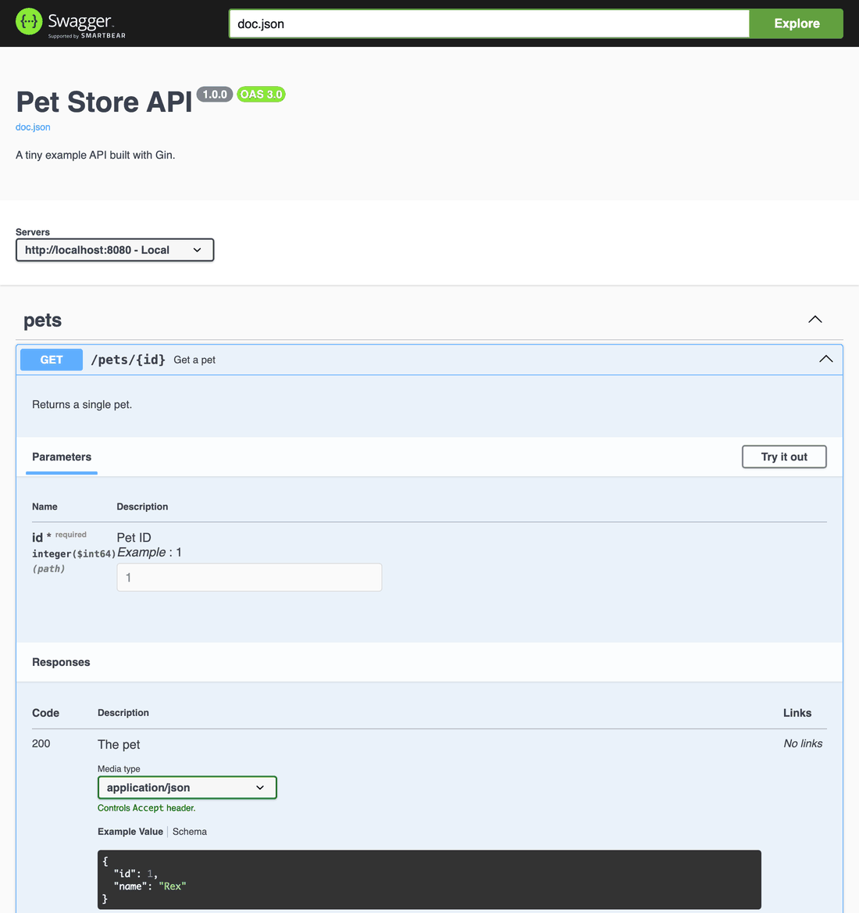

# go-swagger3

**Generate OpenAPI 3 specs from Go code annotations.** A [swaggo/swag](https://github.com/swaggo/swag) alternative
with native OpenAPI 3.0 output, swag-style comments, generics, and built-in Swagger UI for Gin, Echo, chi, Fiber and
more.

[](https://github.com/parvez3019/go-swagger3/actions/workflows/ci.yml)
[](https://pkg.go.dev/github.com/parvez3019/go-swagger3)
[](https://github.com/parvez3019/go-swagger3/releases/latest)
[](LICENSE)
[](https://parvez3019.github.io/go-swagger3/)

> [!TIP]
> **[Read the docs](https://parvez3019.github.io/go-swagger3/)** ·
> Guides for [Gin](https://parvez3019.github.io/go-swagger3/frameworks/gin/),
> [Echo](https://parvez3019.github.io/go-swagger3/frameworks/echo/),
> [chi](https://parvez3019.github.io/go-swagger3/frameworks/chi/),
> [Fiber](https://parvez3019.github.io/go-swagger3/frameworks/fiber/) ·
> [Migrating from swag](https://parvez3019.github.io/go-swagger3/MIGRATION_FROM_SWAG/)

<p align="center">
  
  <br><sub>The Pet Store example from the <a href="https://parvez3019.github.io/go-swagger3/frameworks/gin/">Gin guide</a>, served by the built-in Swagger UI.</sub>
</p>

## Quick start

**1. Install**

```shell
go install github.com/parvez3019/go-swagger3@latest
```

Requires Go 1.24+. Prebuilt binaries and a Docker image are also available: see [Install](docs/cli.md#install).

**2. Annotate.** Describe the API in `main.go` and each operation on its handler:

```go
// main.go
// @Version 1.0.0
// @Title Pet Store API
// @Server http://localhost:8080 Local
package main
```

```go
// handlers.go
type Pet struct {
	ID   int64  `json:"id" example:"1"`
	Name string `json:"name" example:"Rex"`
}

// @Title Get a pet
// @Param id path int true "Pet ID"
// @Success 200 object Pet "The pet"
// @Resource pets
// @Route /pets/{id} [get]
func GetPet(c *gin.Context) { /* ... */ }
```

**3. Generate**

```shell
go-swagger3 --module-path . --output oas.json --schema-without-pkg
```

<details>
<summary>Generated <code>oas.json</code> (<code>servers</code> block omitted)</summary>

```json
{
  "openapi": "3.0.0",
  "info": {
    "title": "Pet Store API",
    "version": "1.0.0"
  },
  "paths": {
    "/pets/{id}": {
      "get": {
        "responses": {
          "200": {
            "description": "The pet",
            "content": {
              "application/json": {
                "schema": {
                  "$ref": "#/components/schemas/Pet"
                }
              }
            }
          }
        },
        "tags": [
          "pets"
        ],
        "summary": "Get a pet",
        "parameters": [
          {
            "name": "id",
            "in": "path",
            "description": "Pet ID",
            "required": true,
            "schema": {
              "type": "integer",
              "format": "int64",
              "description": "Pet ID"
            }
          }
        ]
      }
    }
  },
  "components": {
    "schemas": {
      "Pet": {
        "type": "object",
        "properties": {
          "id": {
            "type": "integer",
            "example": 1
          },
          "name": {
            "type": "string",
            "example": "Rex"
          }
        }
      }
    }
  }
}
```

</details>

**4. Serve Swagger UI** (Gin shown; [adapters for other frameworks](https://parvez3019.github.io/go-swagger3/serving-swagger-ui/#framework-adapters)):

```shell
go get github.com/parvez3019/go-swagger3/swagger/gin
```

```go
import (
	_ "embed"

	"github.com/parvez3019/go-swagger3/swagger"
	ginswagger "github.com/parvez3019/go-swagger3/swagger/gin"
)

//go:embed oas.json
var spec []byte

r.Any("/swagger/*any", ginswagger.WrapHandler(spec, swagger.Title("Pet Store API")))
```

Open `http://localhost:8080/swagger/index.html`. The [full Gin guide](https://parvez3019.github.io/go-swagger3/frameworks/gin/) has the complete, runnable `main.go`.

## How it compares

| | go-swagger3 | [swaggo/swag](https://github.com/swaggo/swag) | [go-swagger](https://github.com/go-swagger/go-swagger) |
|---|---|---|---|
| Output | **OpenAPI 3.0** | Swagger 2.0 (v1); OpenAPI 3.1 in v2 release candidates | Swagger 2.0 only |
| Approach | Comments → spec | Comments → spec | `swagger:` comments → spec; also generates code from a spec |
| Annotation style | `@Param`, `@Success`, `@Router`… (swag-like) | `@Param`, `@Success`, `@Router`… | `swagger:route`, `swagger:model`… |
| Generics | Yes (`Page[Pet]`) | Yes | Limited |
| Swagger UI | Built in: net/http, Gin, Echo, chi, mux, Fiber, Hertz, Buffalo, Flamingo, Atreugo | Separate packages (`gin-swagger`, `echo-swagger`, …) | `swagger serve` command |
| Annotation formatter | `go-swagger3 fmt` | `swag fmt` | No |

Already using swag? Most annotations work unchanged: see the [migration guide](docs/MIGRATION_FROM_SWAG.md).

## Features

- **OpenAPI 3.0** output in JSON or YAML.
- **swag-compatible annotations:** `@Param` with `Enums()`, `default()`, `minimum()`…; `@Accept`/`@Produce`;
  `@Router` alias; `@OperationId`; `@deprecated`.
- **Schemas from Go types:** generics, composition (`JSONResult{data=Order}`), maps, pointers as `nullable`,
  `oneOf`/`anyOf`/`allOf`/`discriminator`, enums, field comments as descriptions.
- **Security:** HTTP, API key, OpenID Connect and OAuth2 schemes, applied globally or per operation.
- **Swagger UI adapters** for ten frameworks, each a separate Go module so you only pull in what you use.
- **Annotation formatter:** `go-swagger3 fmt`.

## Documentation

Full docs: **[parvez3019.github.io/go-swagger3](https://parvez3019.github.io/go-swagger3/)**

| Page | Contents |
|------|----------|
| Framework guides | OpenAPI 3 + Swagger UI step by step for [Gin](https://parvez3019.github.io/go-swagger3/frameworks/gin/), [Echo](https://parvez3019.github.io/go-swagger3/frameworks/echo/), [chi](https://parvez3019.github.io/go-swagger3/frameworks/chi/), [Fiber](https://parvez3019.github.io/go-swagger3/frameworks/fiber/), [Hertz](https://parvez3019.github.io/go-swagger3/frameworks/hertz/), [gorilla/mux](https://parvez3019.github.io/go-swagger3/frameworks/gorilla-mux/), [net/http](https://parvez3019.github.io/go-swagger3/frameworks/net-http/) |
| [Install & CLI](https://parvez3019.github.io/go-swagger3/cli/) | Install options, flags, Docker, `fmt` |
| [Annotation reference](https://parvez3019.github.io/go-swagger3/annotations/) | Service info, parameters, headers, responses, tags, routes, struct tags, enums |
| [Security](https://parvez3019.github.io/go-swagger3/security/) | Security schemes, OAuth2 flows and scopes |
| [Serving Swagger UI](https://parvez3019.github.io/go-swagger3/serving-swagger-ui/) | net/http handler and all framework adapters |
| [Comparison](https://parvez3019.github.io/go-swagger3/comparison/) | go-swagger3 vs swaggo/swag vs go-swagger |
| [Migrating from swag](https://parvez3019.github.io/go-swagger3/MIGRATION_FROM_SWAG/) | Annotation-by-annotation mapping |
| [Examples](examples/) | Runnable net/http, Gin, Echo and chi samples |

## AI agent skills

Copy these into Claude Code or Cursor projects so agents can annotate existing Go APIs and generate OpenAPI 3 specs
with go-swagger3:

| Agent | Source | Copy to |
|-------|--------|---------|
| Claude Code | [agent-skills/claude/SKILL.md](agent-skills/claude/SKILL.md) | `.claude/skills/go-swagger3-docs/SKILL.md` |
| Cursor | [agent-skills/cursor/cursor_rules.mdc](agent-skills/cursor/cursor_rules.mdc) | `.cursor/rules/go-swagger3.mdc` |

## Limitations

- Go modules only.
- Anonymous (unnamed) embedded struct fields have limited support; prefer named types.
- Output is OpenAPI **3.0.0** (3.1 is planned).
- Routes come from annotations (`@Route` / `@Router`); framework routers are not introspected.

## Contributing

Bug reports, feature requests and pull requests are welcome. See [CONTRIBUTING.md](CONTRIBUTING.md) to get started,
and look for issues labelled [`good first issue`](https://github.com/parvez3019/go-swagger3/labels/good%20first%20issue).
Using go-swagger3 in a project? Tell us in [Show and tell](https://github.com/parvez3019/go-swagger3/discussions/categories/show-and-tell).

## Acknowledgements

go-swagger3 builds on [mikunalpha/goas](https://github.com/mikunalpha/goas),
[yvasiyarov/swagger](https://github.com/yvasiyarov/swagger) and [uudashr/go-module](https://github.com/uudashr/go-module),
and takes feature inspiration from [swaggo/swag](https://github.com/swaggo/swag).

## Star history

[](https://www.star-history.com/?repos=parvez3019%2Fgo-swagger3&type=date&legend=top-left)
